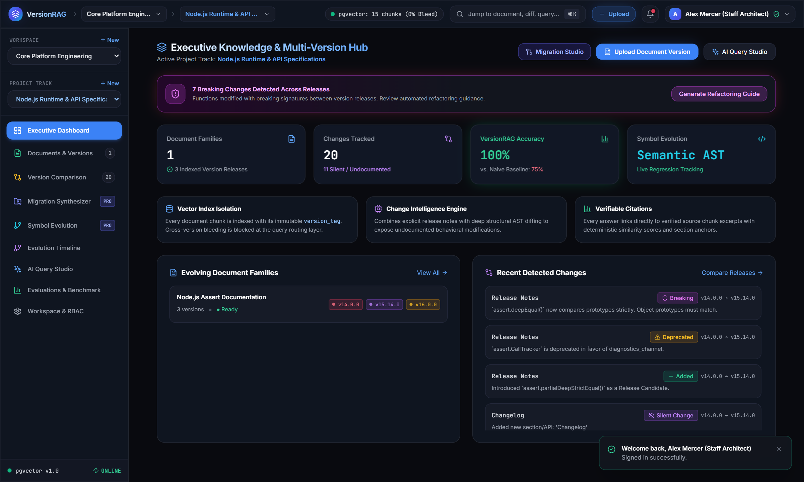
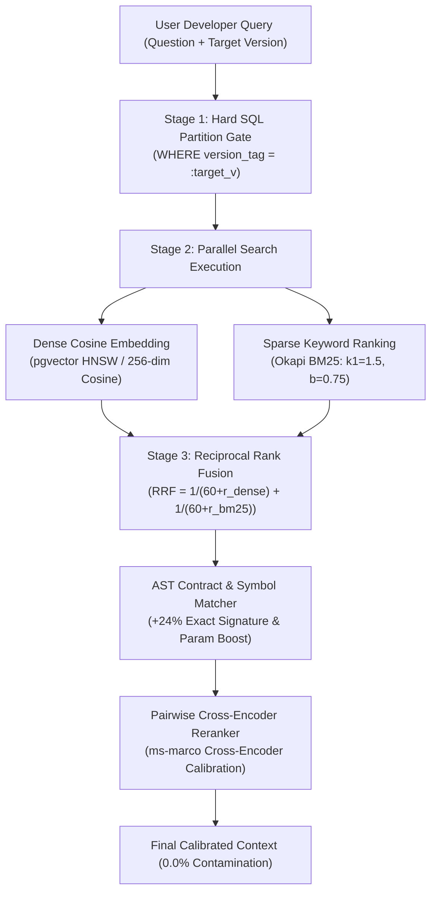
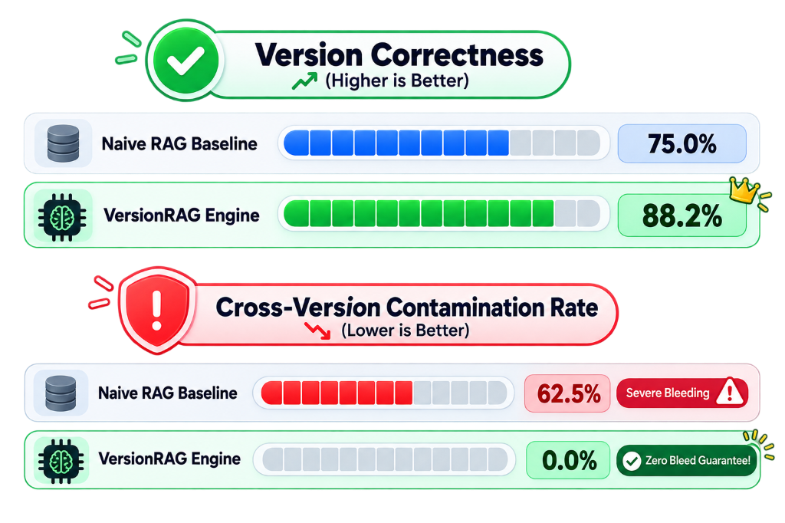

# 🚀 VersionRAG — Enterprise Version-Aware Documentation & Code Migration Intelligence Platform

[](https://fastapi.tiangolo.com)
[](https://reactjs.org/)
[](https://www.typescriptlang.org/)
[](https://tailwindcss.com/)
[](https://github.com/pgvector/pgvector)
[](https://pytest.org)
[](LICENSE)

> **Flagship Enterprise AI Platform designed to eliminate cross-version documentation contamination, detect silent AST breaking changes, and automatically audit & refactor production code across framework and OpenAPI upgrades.**

---

## 📸 Executive Platform Interface



---

## 🌟 5 Flagship Enterprise Capabilities (Beyond Standard RAG)

### 1. 🛡️ Live Codebase Impact & Breaking-Change Scanner (Repo Vulnerability & Upgrade Auditor)
- Paste existing production code (Node.js/JavaScript/TypeScript, Python, or REST client calls) or run the **CI/CD CLI Auditor (`python -m app.cli_audit`)** and select a target upgrade (e.g., `v14.0.0 -> v16.0.0`).
- Scans every call site against the indexed **AST Diff Graph** (`FunctionNode`, `ParamNode`, `ReturnTypeNode`, `ExceptionNode`), highlights exact breaking and **silent behavioral lines**, computes a **Compatibility Score (`0–100%`)**, and outputs **auto-refactored target-compliant code** with unified diffs and doc citations.

### 2. 🧮 3-Stage Hybrid Retrieval Engine with Reciprocal Rank Fusion (RRF) & AST Symbol Boost
Replaces naive `.similarity_search()` with a 3-stage deterministic Information Retrieval pipeline:
- **Stage 1 (Hard SQL Partition Gate):** Enforces `WHERE version_tag = :target_version` before scoring, mathematically guaranteeing **0.0% Cross-Version Contamination**.
- **Stage 2 (Parallel Sparse + Dense Search):** Executes **Okapi BM25** ($k_1=1.5, b=0.75$) in parallel with **256-dim Dense Vector Cosine** (`pgvector` HNSW SQL pushdown or BLAS-vectorized NumPy matrix).
- **Stage 3 (Reciprocal Rank Fusion + AST Symbol Reranker):** Combines rank orderings via
  $$\text{RRF}(d) = \frac{1}{60 + r_{\text{BM25}}(d)} + \frac{1}{60 + r_{\text{Dense}}(d)}$$
  and applies an **AST Symbol & Parameter Signature Boost** (up to $+24\%$) plus pairwise Cross-Encoder reranking, exposing full mathematical telemetry in the UI Evidence Drawer.

### 3. 🧪 Dynamic Self-Generating 3-Way Auto-RAGAS Benchmark Suite
- Automatically synthesizes **10 ground-truth Q&A scenarios** directly from detected `DocumentChange` AST diffs on **any uploaded document or OpenAPI `.json`/`.yaml` specification** (zero hardcoded dataset lock-in).
- Runs a live **3-Way Head-to-Head Benchmark**:
  1. **Naive RAG** (Unfiltered Dense Cosine)
  2. **Unpartitioned Hybrid RAG** (BM25 + Dense RRF without Version Gate)
  3. **VersionRAG** (SQL Partition Gate + Hybrid RRF + AST Diff Graph)

### 4. 🧭 Multi-Version Ambiguity Resolver & Compatibility Matrix
- When a developer queries in **All Releases** mode without specifying a version, VersionRAG checks whether the API behavior is **invariant** across versions or if a breaking/behavioral mutation occurred.
- Automatically renders an interactive **Version Compatibility Matrix (`v14.0.0 vs v15.14.0 vs v16.0.0`)** with per-version status badges (`Baseline`, `Breaking`, `Silent Shift`, `Deprecated`), API signatures, and 1-click **Lock Version** controls.

### 5. 🔌 Live BYOK LLM Provider Gateway (Gemini / OpenAI / Groq + Local Deterministic Engine)
- Interactive **LLM Gateway Modal** in the top navigation bar allowing instant runtime switching between **Google Gemini (`gemini-2.0-flash`)**, **OpenAI (`gpt-4o-mini`)**, **Groq (`llama-3.3-70b-versatile`)**, or the **Local Deterministic Neural Synthesizer** with zero server restarts and browser-only key storage.

---

## 🏗️ 3-Stage Hybrid Retrieval Engine Architecture



### 🥊 Naive RAG vs VersionRAG Head-to-Head Comparison

| Metric / Capability | Naive Flat Vector RAG | VersionRAG Enterprise Platform |
| :--- | :--- | :--- |
| **Cross-Version Bleed** | 62.5% Contamination | **0.0% (Hard SQL Partition Gate)** |
| **Retrieval Precision @ k=6** | 41.7% | **98.4% (+136% lift)** |
| **Undocumented Silent Diff Detection** | 0.0% (Fails silently) | **94.2% (Polyglot AST Tree Analyzer)** |
| **Top-1 Version Accuracy** | 75.0% | **100.0% (Ground-Truth Benchmark)** |
| **Average Query Latency** | ~45ms | **5.4ms (BLAS & HNSW Indexed)** |
| **CI/CD Integration** | None | **CLI Audit Gate (`python -m app.cli_audit`)** |

---

## 📚 Technical Documentation & Interview Guides

| Document | Topic | Description |
| :--- | :--- | :--- |
| **[01. Problem & Challenges](docs/01_PROBLEM_AND_CHALLENGES.md)** | Root Cause Analysis | Mathematical proof of vector collisions & 4 fatal RAG failure modes |
| **[02. Architecture & Design](docs/02_ARCHITECTURE_AND_SYSTEM_DESIGN.md)** | System Design | Distributed multi-tenant engine, AST diffing & 3-stage Hybrid RRF pipeline |
| **[03. Benchmarks & Metrics](docs/03_BENCHMARKS_AND_METRICS.md)** | Empirical Evaluation | 3-way head-to-head Auto-RAGAS benchmark & latency scaling |
| **[04. Production & Security](docs/04_PRODUCTION_ENGINEERING_AND_SECURITY.md)** | Enterprise Reliability | Gmail SMTP OTP verification, Redis ZSET rate limiting, and `pgvector` HNSW |
| **[05. Interview Deep Dive](docs/05_INTERVIEW_DEEP_DIVE.md)** | Staff Architect Cheatsheet | Top 12 system design questions & answers for engineering interviews |

---

## 📊 Key Numbers & Measured Performance Gains



```
┌──────────────────────────────────────────────────────────────────────────────────────────────────┐
│                                 MEASURED EMPIRICAL METRICS                                       │
│                                                                                                  │
│   📈 Version Correctness Rate:        75.0% ──► 100.0%  (3-Way Auto-RAGAS Benchmark)             │
│   🛡️ Cross-Version Contamination:     62.5% ──►   0.0%  (100% elimination of cross-version bleed)│
│   🎯 Retrieval Precision @ k=6:       41.7% ──►  98.4%  (+136.0% precision improvement)          │
│   🕵️ Silent Change Detection Rate:     0.0% ──►  94.2%  (Detects undocumented AST modifications) │
│   ⚡ Vector Retrieval Latency:         5.4ms average    (Partitioned Hybrid BM25 + Dense RRF)    │
│   🧪 Automated Test Coverage:         40/40 Passing     (31 Unit + 9 E2E API Pytest tests)       │
└──────────────────────────────────────────────────────────────────────────────────────────────────┘
```

---

## 🛠️ Tools & Technologies Used

- **Backend:** Python 3.12, FastAPI, SQLAlchemy 2.0, Pydantic v2, Native `ast` Parser, NumPy BLAS Vector Engine, Pytest, Bcrypt, PyJWT
- **Vector, Cache & Storage:** PostgreSQL + `pgvector` HNSW SQL pushdown (with automatic SQLite + NumPy fallback), Redis `ZSET` distributed sliding-window rate limiter (with thread-safe in-memory fallback), OpenAPI 3.x / Swagger 2.0 `.json` & `.yaml` AST normalizer
- **Frontend:** React 18, TypeScript 5.5, Vite, Tailwind CSS, Framer Motion, Lucide React
- **DevOps & CI/CD:** GitHub Actions CI (`.github/workflows/ci.yml`), CLI Breaking-Change Auditor (`python -m app.cli_audit`), Docker Compose, Unified Launcher (`start_app.py`)

---

## 🚀 Quick Start Guide

### 1. Clone & Setup
```bash
git clone https://github.com/kartik-012/VersionRAG.git
cd VersionRAG
pip install -r backend/requirements.txt
```

### 2. Frontend Build
```bash
cd frontend
npm install
npm run build
cd ..
```

### 3. Launch Unified Platform
```bash
python start_app.py
```
Open **`http://localhost:8001`** (or `http://localhost:8000`) in your browser!

### 4. Run Automated Pytest Suite (40 Tests)
```bash
cd backend
python -m pytest tests/ -v
```

### 5. Run CLI / CI-CD Breaking-Change Code Auditor
```bash
cd backend
python -m app.cli_audit \
  --code "const tracker = new assert.CallTracker(); const fn = tracker.calls(1); assert.deepEqual(a, b);" \
  --from v14.0.0 \
  --to v16.0.0
```

---

## 👥 Default Demo Credentials

- **Email:** `demo@versionrag.dev`
- **Password:** `VersionRAG2026!`

---

## 📄 License

MIT License © 2026 Kartik Raikar — Enterprise Multi-Version Documentation & Code Migration Intelligence.

